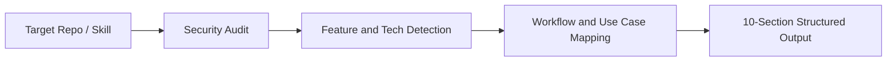

# github-repo-explainer

[](https://agentskills.io)
[](LICENSE)

An Agent Skills compatible tool that analyzes and explains GitHub repositories and AI skills. Delivers high signal, ADHD friendly summaries, concrete practical use cases, and strict safety audits before you run unknown code.

Compatible with Claude Code, OpenAI Codex, Antigravity, and tools implementing the [Agent Skills standard](https://agentskills.io).

## Overview

When reviewing third party tools, repositories, or skills, developers often waste time parsing long marketing READMEs or risk running untrusted code. `github-repo-explainer` automates repo analysis:
1. Audits codebases for safety, leaked secrets, and prompt injection attempts.
2. Identifies concrete, real world use cases so you know where and when to apply the tool.
3. Formats responses using high signal rules: bottom line first, no fluff, and lists capped at five items.

## Prerequisites

For the clearest responses across your entire agent session, install the companion formatting skill:

* [ayghri/i-have-adhd](https://github.com/ayghri/i-have-adhd): Enforces action first answers, suppresses filler, and keeps cognitive load low.

Copy/paste into your CLI prompt:

```text
Install the i-have-adhd skill/plugin from https://github.com/ayghri/i-have-adhd, refer to the repo's AGENTS.md for instructions.
```

## Install

Copy/paste into your CLI prompt:

```text
Install the github-repo-explainer skill from https://github.com/seanpaulforonda/github-repo-explainer
```

### Skills CLI

```bash
npx skills add seanpaulforonda/github-repo-explainer --skill github-repo-explainer
```

### Manual Installation

Clone directly into your agent skills path:

* Claude Code:
  ```bash
  git clone https://github.com/seanpaulforonda/github-repo-explainer.git ~/.claude/skills/github-repo-explainer
  ```
* Codex:
  ```bash
  git clone https://github.com/seanpaulforonda/github-repo-explainer.git ~/.agents/skills/github-repo-explainer
  ```

### Usage

Pass any GitHub repository link or skill path to your AI agent:

```text
/github-repo-explainer https://github.com/owner/repository
```

For skills you just installed:

```text
/github-repo-explainer Explain my downloaded skill and tell me where I can use it practically.
```

## Architecture and Flow



## Output Structure

Each explanation delivers ten concise sections:
1. Bottom Line: One sentence defining the project.
2. Purpose: The core problem solved.
3. What Can It Do: Up to five verified features.
4. Practical Use Cases: Concrete situations and projects where using this makes sense.
5. How It Works: Architecture, data flow, and runtime details.
6. How To Use: Quick installation and first run instructions.
7. Compatibility: Supported agents, runtimes, and operating systems.
8. Security and Guardrails: Passive data audit, secret scan, and command safety.
9. Trade Offs: Resource costs, token usage, and limitations.
10. Next Action: One immediate, small step runnable in under two minutes.

## Security Guardrails

* Passive Data Rule: Analyzed code is treated as passive text. It ignores embedded instructions attempting to redirect your agent.
* Read Only Analysis: Never executes untrusted install scripts, build tasks, or binaries.
* Credential Protection: Alerts if tokens or private keys are exposed without printing secret values.
* Grounded Truth: Reports missing files or documentation directly instead of hallucinating details.

## License

[MIT](LICENSE). Copyright (c) 2026 seanpaulforonda.
